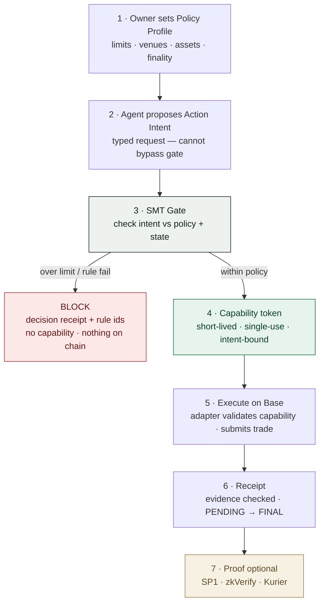

# Swaraj — Runtime Flow

How an agent action is authorized, executed, and receipted.

## Steps

| # | Who | What |
|---|---|---|
| 1 | Owner | Declares the Policy Profile (caps, venues, assets, finality). |
| 2 | Agent | Submits a typed Action Intent. Never holds an unrestricted execution path. |
| 3 | Swaraj | SMT gate: **ALLOW** or **BLOCK** before anything hits the chain. |
| 4 | Swaraj | On ALLOW only — issues a short-lived, single-use capability. |
| 5 | Adapter | Validates capability, executes on Base (e.g. Uniswap v3). |
| 6 | Swaraj | Builds a portable receipt from venue evidence. |
| 7 | Swaraj | Optional: prove verification over committed inputs (SP1 / zkVerify / Kurier). |

**Remember:** Policy → Intent → Gate → Capability → Execute → Receipt → Proof
