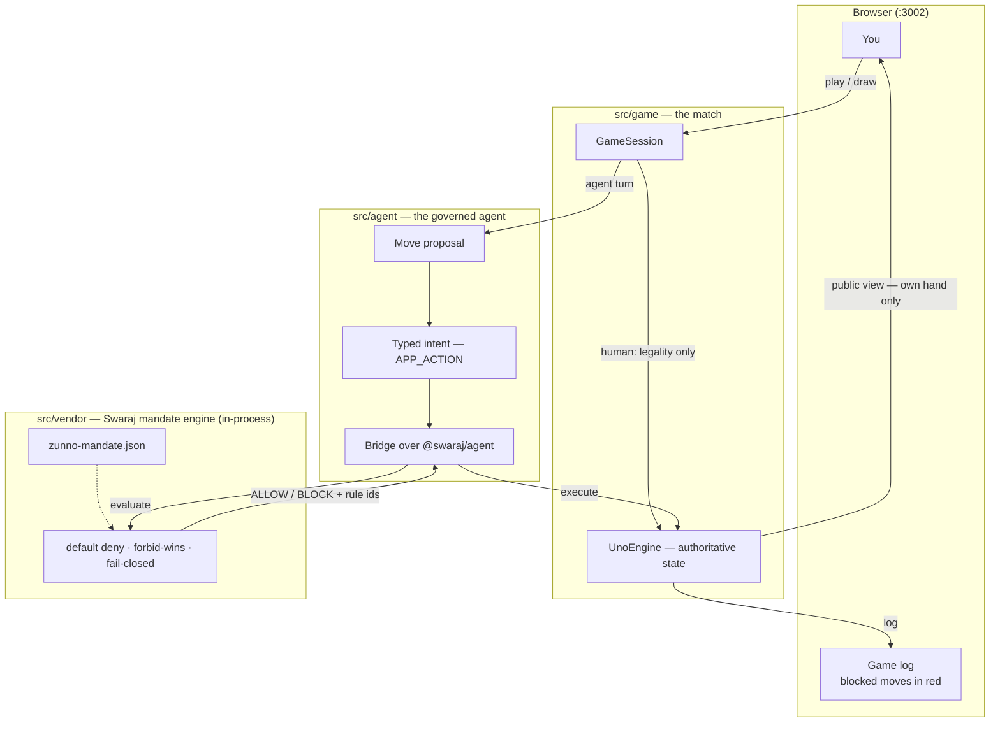

# swaraj-zunno

UNO against an AI agent governed by [Swaraj](https://github.com/Drongo-Labs/Swaraj):
every agent move is a typed intent checked against a formally verified Agent
Mandate before it executes — nothing moves without an ALLOW.

```
Player ──► game engine (legality only)
Agent  ──► typed intent ──► Swaraj gateway (default deny)
                                 ├─ ALLOW → execute
                                 └─ BLOCK → rule named → fallback / abstain
```

## Play it

```sh
pnpm install
pnpm play          # → http://127.0.0.1:3002
```

Fully standalone: the Swaraj mandate engine (`src/vendor/`, vendored from
swaraj-new) evaluates every agent move **in-process** — default deny,
forbid-wins, fail-closed. No other checkout, no database, no chain needed.

- You play UNO normally; your moves are checked for game legality only.
- The agent's every move is checked against its mandate first. The mandate
  forbids Wild+4 (`cardValue > 104`), so when the agent's only playable card
  is a Wild+4 it is **blocked and draws instead** — visible in red in the
  game log.
- Local mode keeps hands in process memory (not TEE-private, not on-chain).

## How it works



**Human path:** click → legality check → applied. The human is never
mandate-checked — formal constraints govern the agent.

**Agent path:** proposal → typed intent → mandate evaluation → ALLOW executes /
BLOCK names the rule → fallback to the next compliant legal card, else a gated
draw, else forfeit the turn. Blocked money actions abstain instead. A blocked
move never mutates state, and an unreachable gateway is treated as BLOCK
(fail-closed) — nothing executes without an ALLOW.

The mandate itself is `mandate/zunno-mandate.json`: permits `play_card` /
`draw_card` on app `zunno`, forbids Wild+4, and caps stakes at 0.01 ETH.

## Formal verification (Lean 4, in this repo)

`lean/` holds a Lean 4.19 suite (no Mathlib), kernel-checked by
`pnpm check:lean`:

- **`Zunno/Engine.lean`** — the UNO engine model with proven invariants: plays
  require a held, legal card; the card moves hand → discard; penalty cards
  conserve exactly; the winner is set exactly by emptying the hand; a draw
  adds one card and passes the turn.
- **`Zunno/Bridge.lean`** — vendored from swaraj-new: `exec_needs_allow` (an
  execution implies an ALLOW preceded it — every path, all fallback retries),
  `all_blocked_never_executes`, `blocked_stake_abstains`.
- **`Zunno/Vectors.lean` + `Zunno/EngineRefinement.lean`** — generated
  (`pnpm vectors && pnpm lean:sync`) from the REAL TypeScript engine. The
  refinement is machine-checked over the entire bounded space: 2,048 states /
  5,888 outcomes where the Lean model must reproduce the TS engine exactly,
  plus a drift-guard test. swaraj-new does the same for the mandate decision
  (7,973 kernel-checked cases, with the concrete characterization theorem
  inherited from the abstract proofs).

Honest scope: the theorems hold for all inputs; the TypeScript correspondence
is bounded-exhaustive. Outside those bounds the correspondence is unproven —
stated, not hidden.

## What a move looks like on the wire

The agent's proposal is plain (`{ kind: "PLAY_CARD", handIndex: 0, cardValue: 11 }`);
what crosses into the mandate engine is the typed intent — real output from
`buildIntent` → `toWire` → the gateway (signature abbreviated):

```json
{
  "intentId": "zunnoce3c7aee408448699add3af6",
  "agent": "zunno-agent",
  "policyHash": "0x0000…0000",
  "timestamp": 1790000000000,
  "expiry": 1790000060000,
  "idempotencyKey": "zunnoce3c7aee408448699add3af6",
  "signature": "0x0000…0000",
  "action": "APP_ACTION",
  "resource": { "app": "zunno", "target": "0x82b2cce9a52c7e56838a5c46833067f9eb006911" },
  "context": {
    "name": "play_card",
    "params": { "handIndex": "0", "cardValue": "11", "chosenColor": "4" }
  }
}
```

Gateway: `{"outcome":"ALLOW","matchedPermitRuleIds":["a_permit_game_actions"]}`

The demo beat — a forbidden Wild+4 (`cardValue: "105"`):

```json
{ "outcome": "BLOCK", "violatedRuleIds": ["a_forbid_wild_draw_four"] }
```

…which the game log shows in red before the agent falls back to a compliant
move. Params are atomic decimal strings (never floats); the same envelope
carries `draw_card` (empty params) and stakes (typed `PAYMENT`).

## Beyond local play

The same bridge runs against a live Swaraj API for durable, proof-backed
decisions (`SWARAJ_API_URL`, `SWARAJ_DEV_TOKEN`), and executes on-chain via
viem (`ZUNNO_E2E_LIVE=1 pnpm e2e` — gated stakes broadcast, over-cap stakes
blocked, receipts promoted to PROVED). On-chain game: the ZunnoInco contract
on Base Sepolia. See the e2e source for the full live flow.

```sh
pnpm test         # unit tests — no services needed
pnpm typecheck
pnpm check:lean   # Lean suite (needs elan)
```
