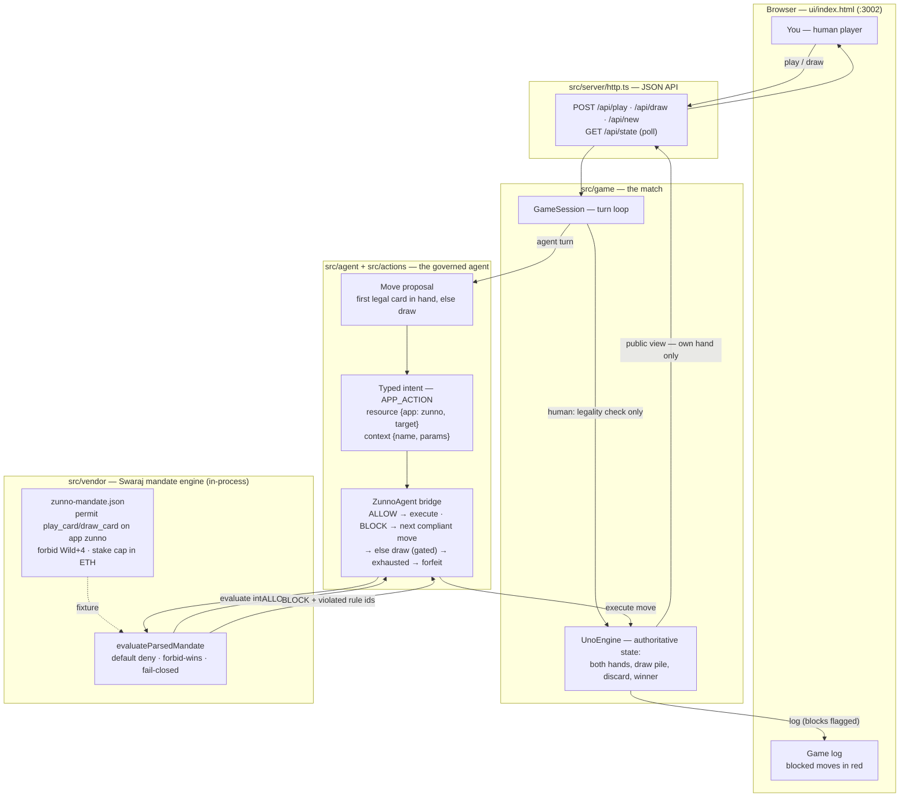

# swaraj-zunno

Swaraj-governed AI agent for **Zunno × Inco** (Base Sepolia): every agent move
is checked against an Agent Mandate before it executes. Implements the plan in
[`swaraj-new/ZUNNO_INCO_SWARAJ_PLAN.md`](../swaraj-new/ZUNNO_INCO_SWARAJ_PLAN.md).

```
Player ── ZunnoInco.sol (Inco, Base)     ← unchanged
Agent ── typed intent ──► Swaraj gateway (Z3, default deny)
                             ├─ ALLOW → execute via the bot wallet path
                             └─ BLOCK → rule ids named → fallback compliant move / abstain
```

## Layout

| Path | Contents |
|---|---|
| `src/zunno/cards.ts` | TS port of the UnoCards.sol codec (`decodeCard`, `isPlayable`, `isWild`) from zunno-inco's bot |
| `src/actions/intents.ts` | Typed-intent builders: STAKE→`PAYMENT`, PLAY_CARD/DRAW_CARD→generic `APP_ACTION` |
| `src/actions/appAction.ts` | Zunno's use of Swaraj's generic `APP_ACTION` (app namespace + atomic decimal params) |
| `src/swaraj/client.ts` | Swaraj API client: mandate registration + unified-action evaluation; fail-closed |
| `src/swaraj/mandateSchema.ts` | Local mirror of the Agent Mandate wire format (incl. param predicates) for offline fixture validation |
| `src/agent/bridge.ts` | The governed turn: gate → execute / fallback (bounded retries) / abstain / forfeit |
| `mandate/zunno-mandate.json` | One mandate: stakes via PAYMENT rules, game moves via APP_ACTION rules (Wild Draw Four forbidden) |

## Rules the agent lives by (blocked-move handling)

- ALLOW executes; BLOCK never mutates state.
- Blocked **stake** → abstain (money actions are never retried blind).
- Blocked **play** → next compliant legal card (each still gated) → else draw (gated) → else forfeit.
- Gateway unreachable or unknown action type ⇒ treated as BLOCK (fail-closed,
  default deny). Nothing executes without an ALLOW.

## Status / next steps

- [x] Intent builders + mandate fixture + governed-turn bridge, unit-tested
      against a fake gateway (`pnpm test`, no services needed).
- [x] Game moves flow through Swaraj's generic `APP_ACTION`
      (swaraj-new `feature/app-action`): `resource {app:"zunno", target}`,
      `context {name, params}` — no per-game schema change needed, and any
      future app reuses the same type.
- [x] Wire `MoveExecutor` to zunno-inco's `gameBot` viem calls
      (`ViemMoveExecutor`: stake→joinGame, playCard, drawCard; dry-run default).
- [x] Live-gateway e2e (`pnpm e2e`): mandate registered, gated stake ALLOW,
      over-cap stake BLOCK by `forbid_stake_over_cap`, APP_ACTION play/draw
      ALLOW, unknown action default-deny. All checks passed.
- [x] Inco attestation provider (`IncoAttestationProvider`): port of
      `incoHand.js` — voucher session + `attestedDecryptWithVoucher`; a card
      the agent does not hold never attests (fail closed).
- [ ] Bind the bot's Base tx hash to the Swaraj receipt (evidence adapters)
      and batch-prove a finished match.

## Play it

```sh
pnpm install
pnpm play          # → http://127.0.0.1:3002
```

Fully standalone: the Swaraj mandate engine (`src/vendor/`, vendored from
swaraj-new) evaluates every agent move **in-process** — default deny,
forbid-wins, fail-closed. No other checkout, no database, no chain needed.

- You play UNO against the agent; your moves are checked for game legality only.
- The agent's every move is a typed intent (`APP_ACTION`) checked against its
  mandate first. The mandate forbids Wild+4 (`cardValue > 104`), so when the
  agent's only playable card is a Wild+4 it is **blocked and draws instead** —
  visible in red in the game log.
- Local mode is not TEE-private and not on-chain: hands live in process memory.
  The on-chain (Inco/Base) and NEAR variants are the architecture docs' job.

## Flow diagram



**Human path (3 steps):** click → `POST /api/play` → engine legality → applied.
The human is never mandate-checked — formal constraints govern the agent.

**Agent path (6 steps):** proposal → typed intent → mandate evaluation
(in-process, vendored Swaraj) → ALLOW executes / BLOCK names the rule →
fallback to the next compliant move, else draw (still gated) → applied to the
engine, block written to the visible log.

## Formal verification (Lean 4, in this repo)

`lean/` holds its own Lean suite (Lean 4.19, no Mathlib) — kernel-checked by
`pnpm check:lean`:

- **`Zunno/Engine.lean`** — the UNO engine model, with proven invariants:
  plays require the card in hand and legal (`play_none_if_not_in_hand`,
  `play_none_if_illegal`); the card moves hand → discard
  (`play_card_on_discard`); penalty cards conserve exactly
  (`play_penalty_split`, take ++ drop is the identity); the winner is set
  exactly by emptying the hand (`play_wins_on_last_card` /
  `play_no_win_otherwise`); a draw adds exactly one card and passes the turn.
- **`Zunno/Bridge.lean`** — the security property of the demo, proven:
  `exec_needs_allow` (an execution in the agent's trace implies the decision
  list ends in ALLOW — every path, all fallback retries),
  `all_blocked_never_executes`, and `blocked_stake_abstains`.
- **`Zunno/Vectors.lean`** — GENERATED (`pnpm vectors && pnpm lean:sync`)
  from the REAL TypeScript engine; every example kernel-checks that the Lean
  model reproduces the TS outcome (same ZunnoInco.sol codec, legality,
  effects, winner). `test/vectors.test.ts` guards against drift between the
  committed vectors and the engine.

Honest scope: the Lean files model the engine and bridge; the vectors
kernel-check TS↔Lean agreement on concrete cases, and swaraj-new's
bounded-exhaustive harness (`packages/rules/test/exhaustive.test.mjs`,
24,990 cases) checks the TS mandate combinatorics against the Lean-proven
characterization across the entire bounded input space. A machine-checked
Lean ⇔ TS correspondence remains future work.

## What a move looks like on the wire

The agent's proposal is plain and app-side; what crosses into the mandate
engine is the typed intent — Swaraj's generic `APP_ACTION` with atomic decimal
params. This is real output from `buildIntent` → `toWire` → the embedded
gateway (signature abbreviated — it is a 130-hex-char `0x…` string):

**Proposal:** `{ kind: "PLAY_CARD", handIndex: 0, cardValue: 11 }` *(red 5)*

```json
{
  "intentId": "zunnoce3c7aee408448699add3af6",
  "agent": "zunno-agent",
  "policyHash": "0x0000…0000",
  "timestamp": 1790000000000,
  "expiry": 1790000060000,
  "idempotencyKey": "zunnoce3c7aee408448699add3af6",
  "signature": "0x0000…0000",
  "action": "APP_ACTION",
  "resource": { "app": "zunno", "target": "0x82b2cce9a52c7e56838a5c46833067f9eb006911" },
  "context": {
    "name": "play_card",
    "params": { "handIndex": "0", "cardValue": "11", "chosenColor": "4" }
  }
}
```

Gateway: `{"outcome":"ALLOW","matchedPermitRuleIds":["a_permit_game_actions"]}`

**The demo beat — a forbidden Wild+4** (`cardValue: 105`, mandate forbids
`cardValue > 104`): identical intent shape, `cardValue: "105"`,
`chosenColor: "1"` →

```json
{ "outcome": "BLOCK", "violatedRuleIds": ["a_forbid_wild_draw_four"] }
```

…which is what the game log shows in red ("Agent tried play_card — BLOCKED
by a_forbid_wild_draw_four") before the agent falls back to a compliant move.

Notes on the shape: `params` values are **atomic decimal strings** (the
schema parses them to big integers — no floats ever); keys are sorted for
canonical hashing regardless of construction order; `chosenColor` 0–3 is a
wild's color pick, 4 means "keep the active color" for non-wilds; the same
envelope carries `draw_card` with empty `params`, and stakes as the typed
`PAYMENT` action (see `pnpm e2e`).

## Remote gateway (optional)

The same bridge runs against a live Swaraj API (`SWARAJ_API_URL` +
`SWARAJ_DEV_TOKEN`, see `pnpm e2e`); the embedded gateway is the offline
drop-in with identical semantics.

## Setup

```sh
pnpm install
pnpm test         # node:test, no database or API needed
pnpm typecheck
```

Against a live Swaraj API (swaraj-new, `apps/api`):

```sh
export SWARAJ_API_URL=http://localhost:3000
export SWARAJ_APPLICATION_ID=zunno
export ZUNNO_GAME_ADDRESS=0x82b2cce9a52c7e56838a5c46833067f9eb006911
```
