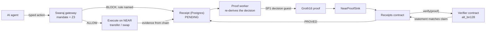

# Swaraj

**Formally checked, provable authorization for autonomous AI agents, settled on NEAR.**

An AI agent that can move money needs limits it can't talk its way around.
Swaraj checks every action an agent proposes against an Agent Mandate before
anything happens. Anything not explicitly permitted is blocked, with the broken
rule named. Every decision becomes a receipt, and with the prover running the
decision is proved with a Groth16 zero-knowledge proof that a NEAR contract
verifies on chain, for blocked actions as well as allowed ones.

Built at [NEAR HACKATHON](https://nearhackathon.com/) (Nov 2026). Everything
below runs on **NEAR testnet**; mainnet is untested.

## What it does

| | |
|---|---|
| **Decide** | A fail-closed gateway evaluates each action against the agent's mandate: FORBID wins, then REQUIRE_APPROVAL, then PERMIT, and anything else is BLOCK. Malformed input blocks. Every decision is then checked independently by the Z3 SMT solver, in the API and in Zunno's embedded gateway; a disagreement or solver failure is a BLOCK (`SWARAJ_Z3_CROSSCHECK=0` turns the check off) |
| **Act** | Permitted actions execute for real: NEAR transfers, NEP-141 token transfers and Ref Finance swaps. Blocked actions never touch the chain |
| **Record** | Every decision, receipt and idempotency claim is stored in Postgres. A database trigger makes illegal receipt moves (like PROVED → PENDING) impossible, even from raw SQL |
| **Prove** | A worker re-derives each decision, proves it with an SP1 Groth16 proof, and settles the receipt on NEAR, where a contract verifies the proof with NEAR's `alt_bn128` host functions |
| **Check** | `swaraj-verify` checks a signed receipt bundle with no Swaraj service, including the NEAR transaction behind it |
| **Proof-carrying requests** | Every ALLOW returns a signed `permit` for that exact action, valid for at most 5 minutes. A counterparty that runs the action itself (an API, a merchant, a tool server) calls `checkPermit` from `@swaraj/verify`, or mounts the `requirePermit` Express middleware with the permit in the `swaraj-permit` header, and refuses any request whose permit is missing, forged, expired, already used, or for a different action. A request that skipped the gateway has no permit, so it is refused |
| **Formal guarantees** | The decision rules are proved in Lean 4 (default deny, forbid always wins, approvals never widen a mandate) |

## How it uses NEAR

| Use | Where |
|---|---|
| **Execution**: NEAR transfers, NEP-141 transfers (`near_ft_transfer`) and Ref Finance swaps, run only after the mandate allows them | `integrations/near` |
| **Evidence**: each transaction is read back from chain, and a receipt fails unless it is final, matches the action and fully succeeded | `integrations/near`, `packages/verify` |
| **Groth16 verifier contract**: verifies SP1 proofs on chain, about 34 Tgas, with no oracle or other chain | `contracts/verifier` |
| **Receipts contract**: a receipt reaches PROVED only when the verifier accepts a proof of its exact claim | `contracts/receipts` |
| **`NearProofSink`**: the proof worker settles receipts on NEAR | `packages/proofs` |
| **Registry contract**: agent registration | `contracts/registry` |
| **Shade Agent** (demo): the AI opponent has its own NEAR account and registers on an agent contract | `examples/zunno` |
| **NEAR AI Cloud** (demo): the opponent picks moves with private inference, after checking the model's TDX and GPU attestation | `examples/zunno` |
| **Wager escrow** (demo): holds a match stake under the mandate's cap, and pays out only on a receipt proved on NEAR | `contracts/wager` |

## How a decision gets proved on NEAR



The proof commits the statement `swaraj/statement/mandate/v1`: the intent hash,
the mandate hash, the decision, the rules that decided it, and the approver and
evidence when present. The SP1 guest computes both hashes from the exact bytes
it evaluates, and the worker refuses any proof whose statement differs from the
recorded decision.

## Live on testnet

| Contract | Account | Proof it works |
|---|---|---|
| Verifier (current) | [`swaraj-verifier-v3-11101557.testnet`](https://testnet.nearblocks.io/address/swaraj-verifier-v3-11101557.testnet) | Verified the ALLOW and BLOCK fixtures ([ALLOW](https://testnet.nearblocks.io/txns/6X5pjp1rFtBxBrJGjVp2nsL1RGdGphVBbanNpSVkZA3z), [BLOCK](https://testnet.nearblocks.io/txns/gdBEzrii87iUegjKkecseZSZ6krdouuYnjRB3ucVNGi)) |
| Receipts | [`swaraj-receipts-11081321.testnet`](https://testnet.nearblocks.io/address/swaraj-receipts-11081321.testnet) | Wired to the v3 verifier. A live allowed action and a live blocked action went from the API to PROVED on chain |
| Registry | [`swaraj-registry-k-7zndxw.testnet`](https://testnet.nearblocks.io/address/swaraj-registry-k-7zndxw.testnet) | Agent registered |
| Wager escrow | [`swaraj-wager-proof-11110149.testnet`](https://testnet.nearblocks.io/address/swaraj-wager-proof-11110149.testnet) | Pays out only on a receipt proved on NEAR: a fake receipt paid nothing ([tx](https://testnet.nearblocks.io/txns/AjN5caaJYwTifUe3TNDwRhwfbHBTLuZpsqUWFwZBPgte)), a proved one paid the 0.2 NEAR pot ([tx](https://testnet.nearblocks.io/txns/5L6gBJhz9UzK6EVo1vSs1VyZWac4kXpNvdVv8cH64T7X)), reusing it was refused ([tx](https://testnet.nearblocks.io/txns/J1PUPHvLvT6KUZyyuShg5uAdycA8PcUvnGgjRVEn11s1)). The earlier owner-settled version, [`swaraj-wager-k-9ldcod.testnet`](https://testnet.nearblocks.io/address/swaraj-wager-k-9ldcod.testnet), rejected an over-cap deposit |
| Shade agent contract | [`zunno-agent-contract-11081501.testnet`](https://testnet.nearblocks.io/address/zunno-agent-contract-11081501.testnet) | The Zunno agent is registered (local mode) |

Contract details, methods and more transactions: [contracts/README.md](contracts/README.md).

## The demo: Zunno

[Zunno](examples/zunno) is UNO against an AI opponent that can't cheat. Every
move the agent proposes goes through Swaraj first, so a forbidden move (like a
Wild +4) is blocked with the rule named and the agent falls back to a legal
move.

- The **rules engine runs as a separate process** that holds the deck and both
  hands. The agent sees only its own hand, through a token-protected API, and
  the engine reports where it runs (`tee: "none"` locally).
- The agent is a **Shade Agent** with its own NEAR account, registered on chain.
- Its moves come from **NEAR AI Cloud**. Before sending any prompt, it checks
  the model's Intel TDX quote, the nonce and key binding, and NVIDIA's GPU
  verdict, and it accepts only replies signed by the attested key.
- **Live gateway mode** sends moves to the real Swaraj API, with mandate rules for
  turn order and the wager cap.
- In live gateway mode the **mandate ledger shows proofs**: how many decisions
  are waiting, and a row for each one once its proof settles on NEAR.
- The mandate is **editable from the dashboard** (Projects → Zunno). In the
  default mode a saved rule applies to the agent's next move, with no restart.
- You have to **call Zunno** with two cards left, or draw two. Only game
  legality applies to you; the mandate governs the agent.

```bash
pnpm --filter swaraj-zunno play      # → http://127.0.0.1:3002
```

Setup for the Shade Agent, NEAR AI and the live gateway is in the
[Zunno README](examples/zunno/README.md).

## Quick start

### 5-minute try — no keys, no database

```bash
pnpm install
pnpm build          # compile the workspace packages; tests and the demo import their dist/
# unit tests that need no services: rules engine, schemas, the Zunno demo
pnpm --filter @swaraj/rules --filter @swaraj/schemas --filter swaraj-zunno test
# NEAR contract tests (Rust toolchain)
cargo test --manifest-path contracts/Cargo.toml
# playable demo: the AI opponent's every move is gated by its mandate
pnpm --filter swaraj-zunno play      # then open http://127.0.0.1:3002
```

In the demo, a forbidden move (e.g. Wild +4) is blocked with the rule named in
the game log, and the agent falls back to a legal move.

### Edit the rules from the dashboard — no keys, no database

```bash
pnpm dev:api:mock     # API on :3000, in memory: no chain, no proofs
pnpm dev:web          # dashboard → http://127.0.0.1:5173
```

Open **Projects → Zunno**, change or add a rule, and **Save to disk**. With
the game running (`pnpm --filter swaraj-zunno play`), the agent's next move is
checked against the saved mandate. **Activate** publishes the mandate to the
API, which is what live gateway mode evaluates against.

### Full setup — database, API, live NEAR (needs Docker; live scenes need testnet keys)

Requirements: Node 22.12+ (24/25 recommended), pnpm 10, Docker, a Rust toolchain,
Lean 4 via elan, and the SP1 toolchain only to generate proofs.

```bash
pnpm install
cp .env.example .env      # local config; never commit .env
pnpm db:up                # Postgres 16 in Docker
pnpm check                # build, typecheck and every TypeScript test
pnpm check:all            # plus Rust, contracts and Lean
```

### Run a NEAR scene (requires a funded testnet account)

```bash
# Fund a testnet account first; these scenes spend real testnet NEAR.
export NEAR_ACCOUNT_ID=<account>.testnet NEAR_PRIVATE_KEY=ed25519:... NEAR_REF_POOL_ID=17
pnpm --filter @swaraj/near near-setup            # once per account, before the first swap
NEAR_DEMO_RECIPIENT=<account>.testnet pnpm --filter @swaraj/near near-demo -- --scene=live.allow
```

Scenes: `live.allow` (transfer), `live.trade` (Ref Finance swap), `live.block`
(over the cap). Without NEAR credentials, actions run against fixtures and end
at `cant_prove`, so a fixture run can never show `proved`.

### Prove live decisions on NEAR (requires the receipts-contract owner key)

Build the decision guest and the native Groth16 host, then start the API with
the NEAR sink. `SWARAJ_FORCE_MOCK=1` turns off the Base/Uniswap pipeline, which
otherwise needs Base keys; NEAR actions and proofs still run for real.

```bash
pnpm --filter @swaraj/proofs build:sp1:decision
(cd packages/proofs/host && cargo build --release --features native-gnark)

SWARAJ_SP1_HOST_BIN=$PWD/packages/proofs/host/target/release/swaraj-gate-host \
SWARAJ_SP1_DECISION_ELF=$PWD/packages/proofs/artifacts/swaraj-decision-guest \
SWARAJ_FORCE_MOCK=1 SWARAJ_PROOF_SINK=near \
NEAR_SINK_ACCOUNT_ID=<receipts contract owner> NEAR_SINK_PRIVATE_KEY=ed25519:... \
NEAR_RECEIPTS_CONTRACT_ID=<receipts contract> \
pnpm dev:api
```

Each proof takes about 6 to 7 minutes and needs up to 16 GB of free memory, so
the API proves one job at a time. A receipt shows PENDING until its proof settles.

## Environment variables

The 5-minute quickstart above needs **none** of these. Copy `.env.example` to
`.env` (`cp .env.example .env`) and fill only what you use — `.env` is
gitignored and keys must never be committed. Full details: [SETUP.md](SETUP.md).

| Variable | Needed for | Where to get it |
|---|---|---|
| `DATABASE_URL`, `POSTGRES_*` | `pnpm db:up`, API, proof worker | local Docker Postgres (compose defaults in `.env.example`) |
| `SWARAJ_URL`, `SWARAJ_DEV_TOKEN`, `SWARAJ_APPLICATION_ID` | SDK / MCP / API calls | any ≥32-char random string; the API enforces it as `Authorization: Bearer …` |
| `SWARAJ_APPROVER_TOKEN` | owner token: human Approve/Reject and mandate/policy changes (once set, the agent's dev token can no longer change its mandate) | separate ≥32-char random string; must differ from `SWARAJ_DEV_TOKEN` |
| `BASE_RPC_URL`, `SWARAJ_EXECUTION_PRIVATE_KEY`, `SWARAJ_SIGNER_PRIVATE_KEY` | live Base trades (real spend) | public RPC (mainnet.base.org / sepolia.base.org); a dedicated funded test wallet — never reuse keys |
| `NEAR_ACCOUNT_ID`, `NEAR_PRIVATE_KEY`, `NEAR_RPC_URL` | live NEAR scenes (`pnpm --filter @swaraj/near near-demo`) | create a testnet account in any NEAR wallet; free testnet NEAR from the faucet (near-faucet.io or `near` CLI); RPC: `https://test.rpc.fastnear.com` |
| `NEAR_DEMO_RECIPIENT`, `NEAR_FT_CONTRACT`, `NEAR_REF_POOL_ID`, `NEAR_REF_CONTRACT` | NEAR demo scenes | your own testnet recipient; FT contract id; Ref Finance pool id (17 = testnet wNEAR/USDT) |
| `SWARAJ_PROOF_SINK=near`, `NEAR_SINK_ACCOUNT_ID`, `NEAR_SINK_PRIVATE_KEY`, `NEAR_RECEIPTS_CONTRACT_ID` | settling receipts on NEAR | the receipts-contract owner account (see `contracts/receipts/DEPLOYMENT.md`); `SWARAJ_PROOF_SINK=near` selects the on-chain sink fail-closed |
| `SWARAJ_SP1_HOST_BIN`, `SWARAJ_SP1_DECISION_ELF`, `SWARAJ_SP1_ELF`, `SWARAJ_SP1_VKEYS` | generating proofs | SP1 toolchain via `sp1up`, then `pnpm --filter @swaraj/proofs build:sp1:decision` and the host build in the README above; needs ~16 GB free per Groth16 proof |
| `KURIER_API_KEY` / `ZKVERIFY_SEED_PHRASE` | zkVerify submission sink | Kurier partner portal (partners.near-intents.org) or a zkVerify account; optional — NEAR sink or the local sink works without them |
| `SHADE_AGENT_CONTRACT_ID`, `SHADE_SPONSOR_ACCOUNT_ID`, `SHADE_SPONSOR_PRIVATE_KEY`, `SHADE_DERIVATION_PATH` | Zunno Shade Agent registration | the deployed agent contract (see `examples/zunno/README.md`) + a sponsor testnet account/key |
| `NEAR_AI_API_KEY` (alias `NEAR_API_KEY`), `NEAR_AI_MODEL`, `NEAR_AI_BASE_URL` | Zunno moves via NEAR AI Cloud private inference | $10 of free credits via the NEAR Builders dashboard (nearbuilders.org/dashboard) or buy at cloud.near.ai; key generated there (hackathon rule Q-000) |
| `ZUNNO_GATEWAY=remote`, `ZUNNO_RPC_URL`, `ZUNNO_HOST`, `ZUNNO_GAME_ID`, `ZUNNO_WAGER_ESCROW`, `ZUNNO_LIVE_STAKE_WEI`, `ZUNNO_LIVE_OVER_STAKE_WEI` | Zunno live-gateway mode | a running Swaraj API + the wager escrow contract; see `examples/zunno/README.md` |
| `ZUNNO_ENCLAVE_URL`, `ZUNNO_AGENT_TOKEN`, `ZUNNO_REQUIRE_TEE=1` | remote/attested rules engine | only when running the engine in a TEE VM instead of the local process |
| `VITE_SWARAJ_URL`, `VITE_SWARAJ_DEV_TOKEN`, `VITE_SWARAJ_APPROVER_TOKEN`, `VITE_SWARAJ_APPLICATION_ID` | web UI (`pnpm dev:web`) | `apps/web/.env`; same values as the API |
| `STRIPE_WEBHOOK_SECRET`, `GITHUB_WEBHOOK_SECRET` | Web2 evidence settlement | your Stripe/GitHub webhook signing secrets; unset = those flows stay pending |

## Repository layout

| Path | Contents |
|---|---|
| `packages/schemas` | Canonical action, mandate, evidence and receipt schemas |
| `packages/rules` | Agent Mandate evaluation: forbid precedence, approvals, default deny |
| `packages/smt` | Integer rule AST, SMT-LIB rendering, Z3 session, fail-closed gateway |
| `packages/crypto` | Canonical hashing, signing, key registry, shared vectors |
| `packages/database` | Migrations, trigger-guarded receipt lifecycle, idempotency, proof queue |
| `packages/proofs` | SP1 guests (decision, Private Mandate) and host, proof worker, `NearProofSink`, Groth16 fixtures |
| `packages/agent` | `GovernedAgent`: propose, gate, execute only on ALLOW |
| `packages/evidence`, `packages/capability`, `packages/receipts` | Evidence normalization, capabilities and budgets, receipt stores |
| `packages/verify` | `swaraj-verify`, the standalone receipt checker |
| `packages/lean` | Lean 4 proofs of the decision rules |
| `packages/sdk`, `packages/contracts` | Typed client and shared API contracts |
| `integrations/near` | Everything NEAR: execution, evidence, settlement, demo scenes |
| `contracts/` | NEAR contracts: `verifier`, `receipts`, `registry`, `wager` |
| `apps/api` | Authorization, execution, receipt and proof service |
| `apps/mcp` | MCP tools, and a fail-closed MCP gateway for agent tool calls |
| `apps/web` | Owner and agent interface |
| `apps/example` | SDK and live-agent example |
| `examples/zunno` | The Zunno demo |
| `web/` | Project website (Next.js) |
| `spec/` | [Receipt format](spec/receipt-v1.md) and [theorem list](spec/theorems.md) |

## Assurance

- **Lean 4:** 30 kernel-checked theorems in `packages/lean`; the main ones are
  listed in [spec/theorems.md](spec/theorems.md). The build rejects `sorry` and added
  axioms. Zunno's Lean suite also proves its game rules and imports Swaraj's
  bridge theorem: nothing executes without an ALLOW.
- **Tests:** about 300 TypeScript tests, the Rust engine and contract tests, and
  opt-in SP1 parity tests that hold the Rust guests to the TypeScript rules
  engine on every case.
- **Contracts:** the verifier is tested against real Groth16 proofs and tampered
  variants. The receipts contract is tested for every illegal move and every
  stranger call.

## Hackathon disclosure

- **Built before the window:** the repository started on Oct 13, 2026. Work
  before the Oct 19 announcement is baseline, including the typed schemas,
  canonical hashing, the Z3 gateway, the Postgres receipt lifecycle, the first
  SP1 proof pipeline, the first Lean suite, the MCP bridge and the web demo.
- **Hackathon diff:** pre-window work lived on two lines that were merged into
  `main` only after Oct 19: `pre-hackathon` (Swaraj's main line, Oct 18) and
  Kushagra's core packages (Oct 13–17). The tag
  [`hackathon-baseline`](https://github.com/Drongo-Labs/Swaraj/tree/hackathon-baseline)
  combines both, and everything built for the hackathon is the direct diff
  [`hackathon-baseline..hackathon-submission`](https://github.com/Drongo-Labs/Swaraj/compare/hackathon-baseline..hackathon-submission).
  The submitted code is tagged
  [`hackathon-submission`](https://github.com/Drongo-Labs/Swaraj/tree/hackathon-submission).
- **Built in the window:** the NEAR integration (execution, evidence,
  settlement), all four NEAR contracts, Groth16 proofs of mandate decisions
  including BLOCK, on-chain verification, `NearProofSink`, Private Mandates,
  human approvals, verified-programs-only mandates, signed receipt bundles and
  `swaraj-verify`, and everything NEAR in Zunno.
- **Other chains:** the Base/Uniswap trade pipeline (the `UNISWAP_V3_BASE`
  venue) and the optional zkVerify/Kurier proof sink were built before the
  window (Oct 14–16) and are not part of the NEAR submission. Both stay off
  unless their keys are set. NEAR is the judged path: execution, evidence,
  proofs and settlement for NEAR payments and Ref Finance swaps.
- **Zunno** moved into this repository on Nov 7, 2026. Its NEAR work (enclave
  process, Shade Agent, NEAR AI, live gateway, wager) was built in the window.
- **Third-party code:** SP1 (Succinct), `near-sdk`, the Shade Agent framework's
  unmodified `shade-contract-template`, `@neardefi/shade-agent-js`, Phala's
  `dcap-qvl`, and the verification steps of NEAR's
  [nearai-cloud-verifier](https://github.com/nearai/nearai-cloud-verifier).
- **AI tools:** parts of the code were written with AI coding assistants,
  including Claude Code, Cursor and Mistral Vibe, and reviewed and tested by the team.
