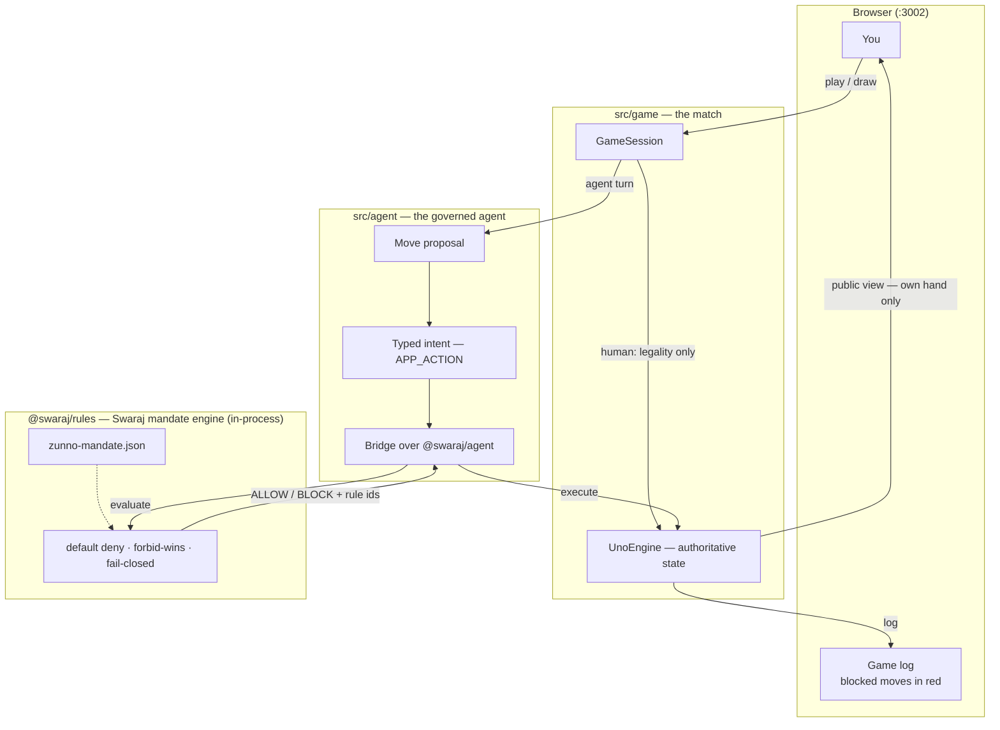

# swaraj-zunno

UNO against an AI agent governed by [Swaraj](https://github.com/Drongo-Labs/Swaraj):
every agent move is a typed intent checked against a formally verified Agent
Mandate before it executes — nothing moves without an ALLOW.

```
Player ──► game engine (legality only)
Agent  ──► typed intent ──► Swaraj gateway (default deny)
                                 ├─ ALLOW → execute
                                 └─ BLOCK → rule named → fallback / abstain
```

## Play it

```sh
pnpm install
pnpm -w build      # compile the @swaraj packages Zunno imports
pnpm play          # → http://127.0.0.1:3002
```

A demo of Swaraj: the mandate engine from this monorepo (`@swaraj/rules`,
`@swaraj/schemas`, `@swaraj/agent`) evaluates every agent move **in-process** —
default deny, forbid-wins, fail-closed. No database or chain needed.

- You play UNO normally; your moves are checked for game legality only.
- The agent's every move is checked against its mandate first. The mandate
  forbids Wild+4 (`cardValue > 104`), so when the agent's only playable card
  is a Wild+4 it is **blocked and draws instead** — visible in red in the
  game log.
- Local mode keeps hands in process memory (not TEE-private, not on-chain).

## Rules engine as an enclave

`pnpm play` starts the rules engine as its own process. It owns the deck and
both hands. The player's page sees only the player's seat, and the agent
process reaches `/agent/*` with its token and sees only its own hand.

`GET /attestation?nonce=<64 hex>` says where the engine runs. Locally it
answers `tee: "none"`, and the game log says so. On an Intel TDX VM it returns
a hardware quote whose report data binds the nonce and the engine's code hash.
That path is written but not yet run on a TDX VM, and the quote is not yet
checked against Intel's collateral.

| Env | Does |
|---|---|
| `ZUNNO_ENCLAVE_URL`, `ZUNNO_AGENT_TOKEN` | Use an engine running elsewhere, such as a TDX VM, instead of starting one |
| `ZUNNO_REQUIRE_TEE=1` | Refuse to play unless the engine reports a TEE |
| `ZUNNO_HOST` | Address the engine listens on (default `127.0.0.1`) |

Until it runs on TDX hardware, don't claim the hands are protected by a TEE.

## Shade Agent (local mode)

With `SHADE_*` set in `examples/zunno/.env`, `pnpm play` registers the agent as
a Shade Agent first: it gets its own NEAR account and registers on an agent
contract, then plays. The contract is the framework's unmodified
`shade-contract-template` (commit `35758f35`), deployed in local mode
(`requires_tee = false`) at `zunno-agent-contract-11081501.testnet`.

In local mode the contract accepts a mock attestation, with all-zero
measurements, from an agent its owner has whitelisted. It proves the agent's
on-chain identity, not that it runs in a TEE.

| Env | Value |
|---|---|
| `SHADE_AGENT_CONTRACT_ID` | The agent contract |
| `SHADE_SPONSOR_ACCOUNT_ID`, `SHADE_SPONSOR_PRIVATE_KEY` | Account that funds the agent (1 NEAR when below 0.5) |
| `SHADE_DERIVATION_PATH` | A secret that keeps the agent's account the same across runs |

One-time setup by the contract owner:

1. Deploy the template with `new(requires_tee=false, attestation_expiration_time_ms, owner_id, mpc_contract_id)`.
2. Approve the mock measurements (all zeros) with `approve_measurements`, and the zero PPID with `approve_ppids`.
3. Whitelist the agent's account with `whitelist_agent_for_local`. `pnpm play` prints the account if it isn't whitelisted.

The template's TEE mode checks a Phala dstack attestation, so a Google Cloud TDX
deploy needs its own attestation check.

## NEAR AI Cloud (private inference)

With `NEAR_AI_API_KEY` or `NEAR_API_KEY` in `.env` (repo root or
`examples/zunno/.env`), the agent picks its moves with a model on NEAR AI Cloud
(default `Qwen/Qwen3.6-35B-A3B-FP8` with reasoning off, or `NEAR_AI_MODEL`;
`NEAR_AI_REASONING` sets `reasoning_effort`, and a move waits at most
`NEAR_AI_TIMEOUT_MS`, 10 seconds by default, before the built-in pick). Before any
prompt is sent, it checks the model's attestation the way NEAR's own verifier
does:

1. The Intel TDX quote verifies against Intel's collateral (`@phala/dcap-qvl-node`).
2. The quote's report data binds the model's signing key and a fresh nonce.
3. The GPU evidence carries the same nonce and passes NVIDIA's verifier.

Every reply must be signed by an attested key over the exact request and
response bytes. A pick is only a proposal: it must be a legal card, and it
still goes through the mandate gateway. If the attestation fails, no prompt is
sent and the agent uses its built-in moves; a bad or unsigned reply falls back
the same way. Verification takes about 5 to 10 seconds per game, and a move about a
second.

## Live Swaraj gateway (Nov 9)

With `ZUNNO_GATEWAY=live` and `SWARAJ_DEV_TOKEN` set, `pnpm play` registers
`mandate/zunno-mandate.json` on the API and evaluates every agent move via
`POST …/unified-actions`. BLOCKs still name the rule in the game log. Without
`ZUNNO_GATEWAY=live`, play stays on the embedded mandate engine (safe default).

```sh
# API on :3010 (or :3000) with SWARAJ_DEV_TOKEN + ZUNNO_GATEWAY=live
SWARAJ_API_URL=http://127.0.0.1:3010 ZUNNO_GATEWAY=live \
  ZUNNO_WAGER_ESCROW=swaraj-wager-proof-11110149.testnet \
  pnpm --filter swaraj-zunno e2e:gateway   # on-turn / off-turn / wager cap scenes
```

Mandate v2 covers:

- legal moves (`play_card` / `draw_card`) with **turn discipline** (`onTurn`)
- ETH stake cap (unchanged)
- **NEAR USDC wager** via service `zunno_wager` (cap 5 USDC atomic)

## NEP-141 wager escrow

Rust contract `contracts/wager` (`swaraj-wager`): deposit up to `max_wager`,
reject over-limit. The pot pays out only on a PROVED receipt for that exact
payout (see `contracts/README.md`); the owner can only refund on cancel.

### Settling a match through a proof

When a game ends in live gateway mode, `pnpm play` pays the pot automatically:
it asks the Swaraj API to allow a `payout` of the whole pot to the winner (the
mandate's `permit_payout` rule), waits until that receipt is PROVED on NEAR
(a few minutes, for the Groth16 proof), then calls the escrow, which pays only
against that receipt. The game log shows each step. To settle by hand:
`pnpm settle -- <winner>.testnet`. Tested on testnet: the API allowed the payout,
its receipt was proved on NEAR, and the escrow paid the 0.2 NEAR pot
([tx](https://testnet.nearblocks.io/txns/5mkTUD5NntbyUoZwHmcvn4GE4xAPEyYmfFhFoyE1mD4Q)).

| Env | Value |
|---|---|
| `ZUNNO_WAGER_ESCROW` | The proof-gated escrow, e.g. `swaraj-wager-proof-11110149.testnet` |
| `ZUNNO_REFEREE_ACCOUNT_ID`, `ZUNNO_REFEREE_PRIVATE_KEY` | Any funded testnet account that sends the payout call; the proof, not this account, authorizes it |
| `ZUNNO_PLAYER_ACCOUNT_ID` | Where the pot goes when you win |
| `ZUNNO_AGENT_NEAR_ACCOUNT` | Where the pot goes when the agent wins, if the Shade Agent isn't registered |
| `SWARAJ_DEV_TOKEN`, `SWARAJ_API_URL` | The live API, which must run with the NEAR proof sink |

```sh
cargo test --manifest-path contracts/Cargo.toml -p swaraj-wager
```

## How it works



**Human path:** click → legality check → applied. The human is never
mandate-checked — formal constraints govern the agent.

**Agent path:** proposal → typed intent → mandate evaluation → ALLOW executes /
BLOCK names the rule → fallback to the next compliant legal card, else a gated
draw, else forfeit the turn. Blocked money actions abstain instead. A blocked
move never mutates state, and an unreachable gateway is treated as BLOCK
(fail-closed) — nothing executes without an ALLOW.

The mandate itself is `mandate/zunno-mandate.json`: permits `play_card` /
`draw_card` on app `zunno`, forbids Wild+4, and caps stakes at 0.01 ETH.

## Formal verification (Lean 4, in this repo)

`lean/` holds a Lean 4.19 suite (no Mathlib), kernel-checked by
`pnpm check:lean`:

- **`Zunno/Engine.lean`** — the UNO engine model with proven invariants: plays
  require a held, legal card; the card moves hand → discard; penalty cards
  conserve exactly; the winner is set exactly by emptying the hand; a draw
  adds one card and passes the turn.
- **`Zunno/Bridge.lean`** — vendored from swaraj-new: `exec_needs_allow` (an
  execution implies an ALLOW preceded it — every path, all fallback retries),
  `all_blocked_never_executes`, `blocked_stake_abstains`.
- **`Zunno/Vectors.lean` + `Zunno/EngineRefinement.lean`** — generated
  (`pnpm vectors && pnpm lean:sync`) from the REAL TypeScript engine. The
  refinement is machine-checked over the entire bounded space: 2,048 states /
  5,888 outcomes where the Lean model must reproduce the TS engine exactly,
  plus a drift-guard test. swaraj-new does the same for the mandate decision
  (7,973 kernel-checked cases, with the concrete characterization theorem
  inherited from the abstract proofs).

Honest scope: the theorems hold for all inputs; the TypeScript correspondence
is bounded-exhaustive. Outside those bounds the correspondence is unproven —
stated, not hidden.

## What a move looks like on the wire

The agent's proposal is plain (`{ kind: "PLAY_CARD", handIndex: 0, cardValue: 11 }`);
what crosses into the mandate engine is the typed intent — real output from
`buildIntent` → `toWire` → the gateway (signature abbreviated):

```json
{
  "intentId": "zunnoce3c7aee408448699add3af6",
  "agent": "zunno-agent",
  "policyHash": "0x0000…0000",
  "timestamp": 1790000000000,
  "expiry": 1790000060000,
  "idempotencyKey": "zunnoce3c7aee408448699add3af6",
  "signature": "0x0000…0000",
  "action": "APP_ACTION",
  "resource": { "app": "zunno", "target": "0x82b2cce9a52c7e56838a5c46833067f9eb006911" },
  "context": {
    "name": "play_card",
    "params": { "handIndex": "0", "cardValue": "11", "chosenColor": "4" }
  }
}
```

Gateway: `{"outcome":"ALLOW","matchedPermitRuleIds":["a_permit_game_actions"]}`

The demo beat — a forbidden Wild+4 (`cardValue: "105"`):

```json
{ "outcome": "BLOCK", "violatedRuleIds": ["a_forbid_wild_draw_four"] }
```

…which the game log shows in red before the agent falls back to a compliant
move. Params are atomic decimal strings (never floats); the same envelope
carries `draw_card` (empty params) and stakes (typed `PAYMENT`).

## Beyond local play

The same bridge runs against a live Swaraj API for durable, proof-backed
decisions (`SWARAJ_API_URL`, `SWARAJ_DEV_TOKEN`).

```sh
pnpm test         # unit tests — no services needed
pnpm typecheck
pnpm check:lean   # Lean suite (needs elan)
```
